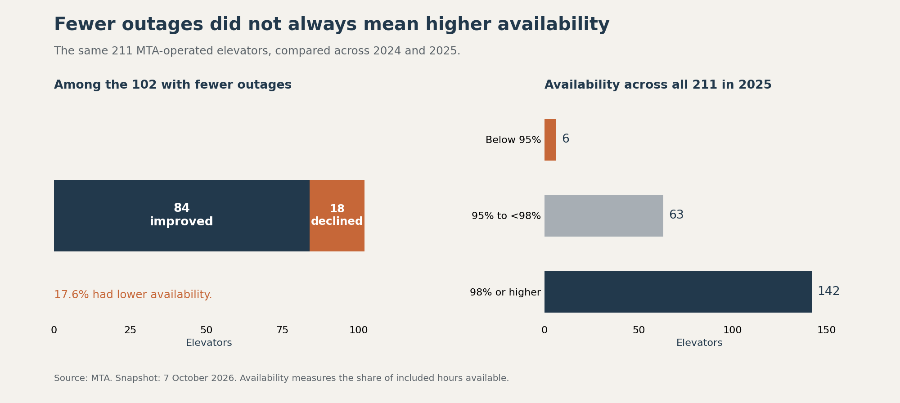

# MTA elevator reliability

**Do fewer outages mean better elevator availability?**

I compared outage counts with time available for the same 211 MTA-operated elevators
in 2024 and 2025. The aim was to understand where an improvement in one measure could
hide a decline in the other.

[Explore the Tableau dashboard](https://public.tableau.com/app/profile/jubyaid.uddin/viz/MTA_Elevator_Reliability_2nd_Draft/NYCElevatorReliability)

## What I found

- Overall availability increased slightly, from **97.97% to 98.06%**.
- **102 elevators had fewer outages.** Of those, 84 improved availability and
  **18 declined**, or 17.6%.
- Across those 18, outages fell **14.2%**, while downtime increased **30.1%**.
- EL194 and EL138 contributed **47% of that group's net additional downtime**.
  Their individual outage records would be a useful starting point for investigation.

The finding is a reason to track interruption frequency and time unavailable together.
It does not establish what caused the declines.

## Data and approach

The source is [MTA NYCT Subway Elevator and Escalator Availability: Beginning 2015](https://data.ny.gov/d/rc78-7x78).
This project uses the included **7 October 2026 snapshot**: 83,079 equipment-month records.
One row represents one piece of equipment in one month, not an individual outage.
The MTA's [overview](docs/dataset_overview.pdf) and
[data dictionary](docs/data_dictionary.pdf) explain the definitions.

I used the two complete years, selected MTA-operated elevators, and required the same
equipment to have full calendar-hour coverage in every month of both years.
This produced **5,064 monthly records for 211 elevators**.

The Python preparation checks equipment-month keys, calculates downtime, aggregates
counts and hours by elevator and year, and joins annual comparison fields back onto
the monthly data for Tableau.

**Availability = total available hours ÷ total included hours.** Monthly percentages
are not averaged. Availability changes are measured in percentage points.

## Run the project

Use Python 3.12. These commands are for macOS or Linux, from the project folder:

~~~bash
python3 -m venv .venv
source .venv/bin/activate
python -m pip install -r requirements.txt
python scripts/prepare_data.py
python scripts/validate_data.py
~~~

The preparation uses the frozen raw snapshot. Validation compares the full output
with the data embedded in the Tableau workbook and rechecks the main findings.
The output matches the reference CSV byte for byte. Results are in
[reports/validation.json](reports/validation.json).

For the analysis, open [notebooks/mta_elevator_analysis.ipynb](notebooks/mta_elevator_analysis.ipynb)
in VS Code, select the project's .venv as the Python kernel, and run the cells in order.
Saved tables and charts can also be read directly on GitHub.

## Files

| Location | Contents |
| --- | --- |
| scripts | Data preparation and validation |
| notebooks | Explained analysis and five charts |
| data/raw | Frozen source snapshot |
| data/processed | Tableau-ready data |
| data/reference | Embedded workbook CSV used for comparison |
| docs | MTA definitions |
| reports | Data validation results |
| assets | Charts generated by the notebook |

## What the data cannot tell me

Outages include scheduled and unscheduled interruptions. Monthly summaries cannot
establish individual repair durations or causes, passenger impacts, or whole-route
accessibility. The selected 18 are not a ranking of all MTA maintenance needs.

The full-calendar rule limits which elevators the findings describe. Some declines
are tiny: EL506's availability fell slightly despite fewer actual downtime hours,
because 2024 was a leap year. Availability bands are descriptive choices, not MTA targets.

---

Jubyaid Uddin
